<a href="https://mihirruwala.cv"><picture><source media="(prefers-color-scheme: dark)" srcset="assets/header-dark.svg?v=4"></picture></a>

Second-year CSE student at VIT Vellore. Frontend is where I'm happiest: I'll happily spend an evening on one transition. The rest of the time I'm reading about why people believe (or don't believe) what an AI tells them.

### Things I've made

- **[DUO](https://github.com/mihirruwala/Duo)**: a private space for two. End-to-end encrypted calls and chat, plus [DUO Control](https://chromewebstore.google.com/detail/duo-control/dladgepdjenmmkehkknjilppcmofaaei), a consent-based tab handover on the Chrome Web Store. [duoforyou.cv](https://www.duoforyou.cv)
- **[Barça Lab](https://github.com/mihirruwala/more-than-a-hack)**: More Than A Hack 2027, team of four. Labels ball possession for every frame of a match from tracking data, with a Kalman filter and a three-state HMM. 0.484 spellF1 on two open Metrica matches vs 0.408 for the baseline. (Yes, that's why the pitch is up there.)
- **[DeepTrace](https://github.com/mihirruwala/DeepTrace)**: a deepfake and AI-face detector for video and photos, [live on Hugging Face Spaces](https://huggingface.co/spaces/ruwalamihir/deepfake_detector). It shows heatmaps of the evidence and publishes its error rates: on my test set it wrongly flagged 2 of 88 real videos and caught 45 of 75 fakes.
- **[D-Mesh](https://mihirruwala.cv/work/dmesh/)**: offline SOS messaging over MultipeerConnectivity on iOS. Field-tested on three iPhones across different floors: 337 of 371 messages reached the rescue station, some relayed through a second phone.

### Research

- **[Detection Without Legitimacy](https://ssrn.com/abstract=7707818)** (SSRN, Nov 2026): how India, Singapore and Malaysia are deciding who gets to call AI content fake, from 40+ days of conversations with researchers in Kuala Lumpur and Singapore. [Read the essay](https://mihirruwala.cv/writing/detection-without-legitimacy/).

<picture><source media="(prefers-color-scheme: dark)" srcset="assets/pitch-dark.svg"></picture>

---

Swift, Python, TypeScript, Next.js, Supabase, Figma · [mihirruwala.cv](https://mihirruwala.cv) · [LinkedIn](https://www.linkedin.com/in/mihir-ruwala-a920433a7/) · [Medium](https://medium.com/@ruwalamihir)
