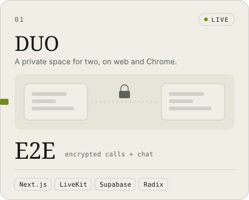
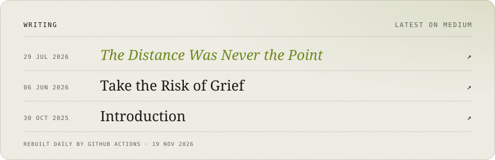
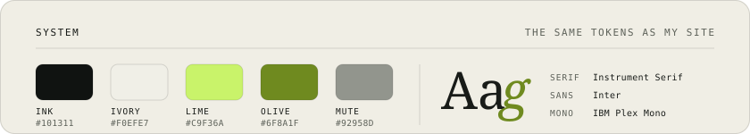

<a href="https://mihirruwala.cv"><picture><source media="(prefers-color-scheme: dark)" srcset="assets/header-dark.svg"></picture></a>

<a href="https://github.com/mihirruwala/Duo"><picture><source media="(prefers-color-scheme: dark)" srcset="assets/duo-dark.svg"></picture></a>
<a href="https://github.com/mihirruwala/more-than-a-hack"><picture><source media="(prefers-color-scheme: dark)" srcset="assets/barca-dark.svg"></picture></a>
<a href="https://github.com/mihirruwala/DeepTrace"><picture><source media="(prefers-color-scheme: dark)" srcset="assets/deeptrace-dark.svg"></picture></a>
<a href="https://mihirruwala.cv/work/dmesh/"><picture><source media="(prefers-color-scheme: dark)" srcset="assets/dmesh-dark.svg"></picture></a>

<b>↳ Open the details on each project</b>

- **[DUO](https://github.com/mihirruwala/Duo)**: a private space for two. End-to-end encrypted calls and chat, plus [DUO Control](https://chromewebstore.google.com/detail/duo-control/dladgepdjenmmkehkknjilppcmofaaei), a consent-based tab handover on the Chrome Web Store. [duoforyou.cv](https://www.duoforyou.cv)
- **[Barça Lab](https://github.com/mihirruwala/more-than-a-hack)**: More Than A Hack 2027, team of four. Labels ball possession for every frame of a match from tracking data, with a Kalman filter and a three-state HMM. 0.484 spellF1 on two open Metrica matches vs 0.408 for the baseline.
- **[DeepTrace](https://github.com/mihirruwala/DeepTrace)**: a deepfake and AI-face detector for video and photos, [live on Hugging Face Spaces](https://huggingface.co/spaces/ruwalamihir/deepfake_detector). It checks faces for swaps, images for AI generation and files for provenance metadata, shows heatmaps of the evidence, and publishes its error rates: on my test set it wrongly flagged 2 of 88 real videos and caught 45 of 75 fakes.
- **[D-Mesh](https://mihirruwala.cv/work/dmesh/)**: offline SOS messaging over MultipeerConnectivity on iOS. Field-tested on three iPhones across different floors: 337 of 371 messages reached the rescue station, some relayed through a second phone. In a second run 96 of 96 arrived, and a relay added about 60 ms.

<b>↳ Research</b>

- *Detection Without Legitimacy*: how India, Singapore and Malaysia build institutional trust around AI-content detection, from 40+ days of fieldwork in Kuala Lumpur and Singapore.

<a href="https://github.com/mihirruwala"><picture><source media="(prefers-color-scheme: dark)" srcset="assets/activity-dark.svg"></picture></a>

<a href="https://medium.com/@ruwalamihir"><picture><source media="(prefers-color-scheme: dark)" srcset="assets/writing-dark.svg"></picture></a>

<a href="https://mihirruwala.cv"><picture><source media="(prefers-color-scheme: dark)" srcset="assets/tokens-dark.svg"></picture></a>

<a href="https://mihirruwala.cv"><b>mihirruwala.cv</b></a> · <a href="https://www.linkedin.com/in/mihir-ruwala-a920433a7/">LinkedIn</a> · <a href="https://medium.com/@ruwalamihir">Medium</a>

